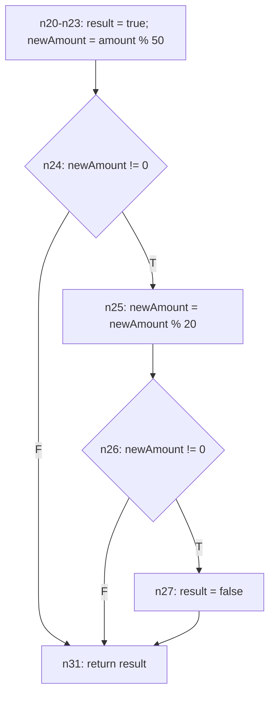
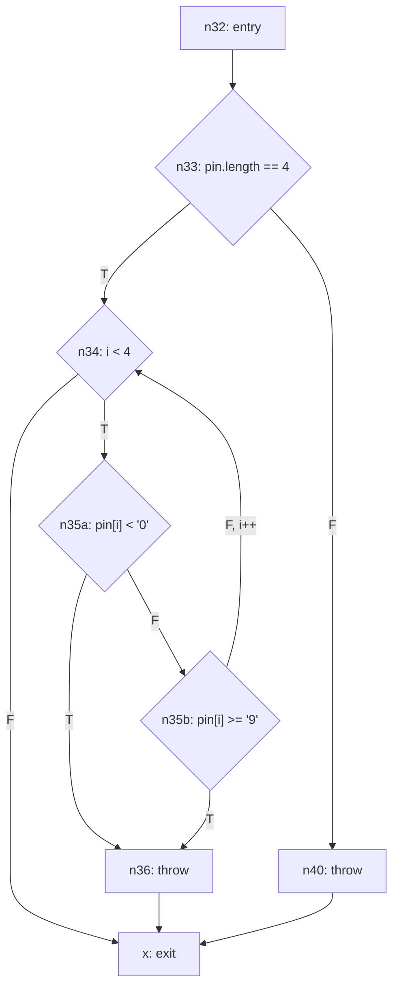
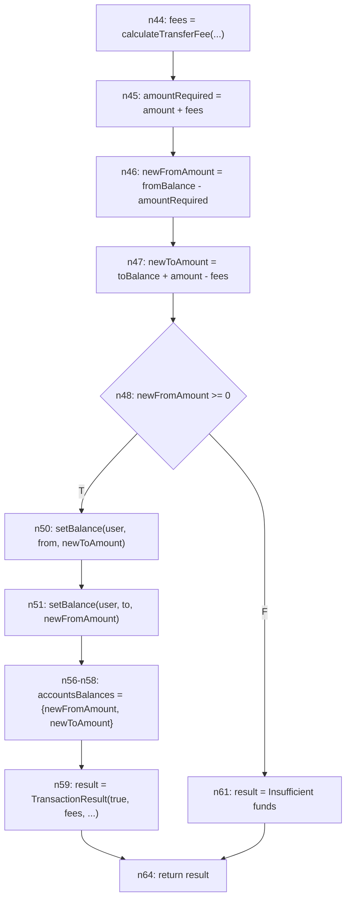

# Assignment 2: White-Box Testing and Fault Localization

CS4472B, group 6. Target: `bank.utils.FeesCalculator`.

| Operation | Technique | Issue | Owner |
|---|---|---|---|
| Withdrawal | Slice on `FinalUse(fee)` + statement coverage | #3 | Tony Wang (@twang849) |
| Deposit | DU-paths for `interestPercentage` + statement coverage | #4 | TODO |
| Transfer | Basis path testing | #5 | Sophia Tong |
| Bonus | Any of the three, outside `FeesCalculator` | #6 | Alexander Perocho (@perochoa) |

> **How to use this file.** Fill in only the sections for your issue and replace their `TODO`
> markers. Don't change another operation's section or the shared conventions; raise changes to
> those on #7 instead. Delete this note in the graded PR.

---

## Conventions

These apply to every section and every test class. Questions and changes go on #7.

### Case IDs
- Prefixes: `WD` (withdrawal), `DP` (deposit), `TR` (transfer), `BN` (bonus).
- Two-digit numbers: `WD-01`, `WD-02`, ... The same ID is used in the test-case table, in the
  `@CsvSource` row, in the results table and in the fault-localization table.

### Floating-point tolerance
- One tolerance for every assertion: `DELTA = 1e-6`.
- Declare it in each test class as `private static final double DELTA = 1e-6;`.

### Control-flow graphs
- Number CFG nodes by **source line** in `src/main/java/bank/utils/FeesCalculator.java` as it is
  on `dev`. A node is written `n<line>` (for example `n30`).
- The source is not changed in this assignment, so the line numbers stay fixed.
- Graphs are drawn in Mermaid (` ```mermaid ` blocks) so they render on GitHub.

Line reference:

| Method | Lines | Target statement |
|---|---|---|
| `calculateWithdrawalFee` | 6–31 | `return fee;` (line 30) |
| `calculateDepositInterest` | 33–73 | `double interest = amount * interestPercentage;` (line 70) |
| `calculateTransferFee` | 75–145 | whole method (basis paths) |

### Inputs and oracles
- Expected values come from the **A2 fee figures in the README**, never from what the code returns.
  The A2 figures differ from A1's.
- Every test-case row cites the README clause its expected value comes from.
- `dayOfWeek` uses `java.util.Calendar` constants: 1 = Sunday, 2 = Monday, ..., 7 = Saturday.
- Expected values are fees in dollars, computed as `amount × percentage` (for example 0.2% of $200 = `0.4`).

### Test classes
- JUnit 5, under `src/test/java` in the package of the class under test.
- One class per issue: `bank.utils.WithdrawalFeeTest`, `bank.utils.DepositInterestTest`,
  `bank.utils.TransferFeeTest`. Bonus classes go in the package of the class they test.
- `@ParameterizedTest` + `@CsvSource`, with the case ID as the first column.
- Every row states the structural element it covers, and every test calls the target method.
- Checkstyle must pass: `mvn -B checkstyle:check`.
- The starter tests (`bank.utils.FeesCalculatorTest`, `atm.ATMTest`) stay in the suite unchanged.
  They're explained under [Test results](#test-results) (#7).

Template (replace the placeholders):

```java
package bank.utils;

import static org.junit.jupiter.api.Assertions.assertEquals;

import org.junit.jupiter.api.DisplayName;
import org.junit.jupiter.params.ParameterizedTest;
import org.junit.jupiter.params.provider.CsvSource;

class XxxFeeTest {
	private static final double DELTA = 1e-6;

	private final FeesCalculator calculator = new FeesCalculator();

	@ParameterizedTest(name = "{0}: {1}")
	@DisplayName("Xxx: <technique>")
	@CsvSource({
		// id, structural element covered, inputs..., expected fee
		"XX-01, '<slice statements / DU-path / basis path>', ..., ...",
	})
	void xxxFee(String id, String covers, /* inputs */ double expected) {
		assertEquals(expected, calculator.calculateXxx(/* inputs */), DELTA);
	}
}
```

### Faults and failure log
- Fault localization: one row per faulty line or condition. Put tests in the same row only if they
  reach the same faulty line.
- Failure log: one failure ID per fault, so it lines up with the fault-localization rows.
- If one test exposes more than one fault, list it on each of those rows.
- Faults found in the same run can share the same times.

### Pull requests
- Short-lived branch off `dev`, PR into `dev`, `phase:tests` label, 3 approvals.
- Quote the JaCoCo numbers from your PR's coverage comment in your section.
- Don't fix faults in the source.

---

## Shared assumptions

1. **Tolerance.** All expected values are compared with `DELTA = 1e-6`, well below one cent and
   far below the gap between any two fee percentages in the specification.
2. **No rounding.** The README tells us to ignore the `round` call for withdrawal and notes
   `Math.round` for deposit. Neither call is in the code: withdrawal returns `amount * feePercentage`
   (line 28) and deposit computes `amount * interestPercentage` (line 70). We analyse the code as it is.
3. **Withdrawal balance of exactly $10,000.** The specification gives a fee for balances below
   $10,000 and for balances above $10,000, but not for exactly $10,000. This is a gap in the
   specification, so no test uses exactly $10,000 as its oracle. Statement coverage of the slice
   does not need that value.
4. **Day of week.** `dayOfWeek` follows `java.util.Calendar`. Saturday (7) and Sunday (1) are the weekend.
5. **Fees are positive amounts in dollars.** Inputs use positive amounts and balances unless a
   section states otherwise.

TODO (#3–#5 owners): add any other assumption your analysis needs here if it affects more than one
operation. Otherwise put it in your own section.

---

## Section 1: Process and assumptions

### 1.1 Withdrawal: slice on `FinalUse(fee)` (#3)

**Slicing criterion:** `FinalUse(fee)`, the statement `return fee;` at line 30 (`n30`) of
`calculateWithdrawalFee`. This is a static backward slice: it holds every statement that can
change the value of `fee` when it is returned.

**The slice:** `S(fee, n30) = { n6, n10, n12, n13, n15, n18, n19, n20, n21, n23, n28, n30 }`

| Node | Statement | Why it is in the slice |
|---|---|---|
| n6 | method entry: parameters `amount`, `accountBalance`, `student`, `dayOfWeek` | Data: defines `amount` (used at n28) and the variables read by the predicates n10, n12, n18, n20 |
| n10 | `if (student)` | Control: decides whether n12 or n18 runs |
| n12 | `if ((dayOfWeek == Calendar.SATURDAY) \|\| (dayOfWeek == Calendar.SUNDAY))` | Control: decides whether n13 or n15 runs |
| n13 | `feePercentage = 0.0;` | Data: definition of `feePercentage` that reaches n28 |
| n15 | `feePercentage = 0.001;` | Data: definition of `feePercentage` that reaches n28 |
| n18 | `if (accountBalance < 1000.00)` | Control: decides whether n19 or n20 runs |
| n19 | `feePercentage = 0.002;` | Data: definition of `feePercentage` that reaches n28 |
| n20 | `else if (accountBalance < 10000.00)` | Control: decides whether n21 or n23 runs |
| n21 | `feePercentage = 0.001;` | Data: definition of `feePercentage` that reaches n28 |
| n23 | `feePercentage = 0.0;` | Data: definition of `feePercentage` that reaches n28 |
| n28 | `double fee = amount * feePercentage;` | Data: the only definition of `fee`, which n30 uses |
| n30 | `return fee;` | The slicing criterion |

**Are the `if` predicates in the slice? Yes.** The four predicates (n10, n12, n18, n20) do not
assign `fee` or `feePercentage`, but they choose which of the five assignments to `feePercentage`
runs. Each assignment is control dependent on its predicate, so the predicates are in the slice.

**Not in the slice:** line 8 (`double feePercentage;`) declares the variable but gives it no value,
so it cannot change `fee`. Every other line that is not listed is a comment, a blank line, a
closing brace or an `else` keyword, not a statement. So every executable statement in the method
except line 8 is in the slice.

**Process.** We started at n30 and walked backwards, adding the reaching definitions of every
variable used (data dependence) and the predicate that controls every statement (control
dependence), until no new statement was added:

| Step | Statement in the slice | Uses | Added | Reason |
|---|---|---|---|---|
| 1 | n30 `return fee` | `fee` | n28 | Only definition of `fee` (data) |
| 2 | n28 `fee = amount * feePercentage` | `amount`, `feePercentage` | n6, n13, n15, n19, n21, n23 | Parameter `amount`; all five definitions of `feePercentage` reach n28 (data) |
| 3 | n13, n15 | — | n12 | Weekend predicate controls them (control) |
| 4 | n19 | — | n18 | `accountBalance < 1000` controls it (control) |
| 5 | n21, n23 | — | n20 | `accountBalance < 10000` controls them (control) |
| 6 | n12, n18, n20 | `dayOfWeek`, `accountBalance` | n10 | `if (student)` controls n12 and n18; n18 controls n20 (control). Variables come from n6 (data) |
| 7 | n10 | `student` | — | n6 is already in the slice; nothing new, so stop |

**Assumptions (withdrawal).**
- The README says to ignore the `round` call; there is no `round` call in the method. Line 28
  returns `amount * feePercentage` with no rounding (Shared assumption 2).
- A balance of exactly $10,000 is a gap in the specification (Shared assumption 3). No test uses
  it, and statement coverage of the slice does not need it.
- `dayOfWeek` follows `java.util.Calendar`: 1 = Sunday, 2 = Monday, 7 = Saturday (Shared assumption 4).
- Every test withdraws `amount = 200`, so each non-zero fee is exact and different
  (0.1% → 0.2, 0.2% → 0.4). A wrong percentage gives a different result, well above `DELTA = 1e-6`.
- Balances are chosen in the middle of each range (500, 5,000, 20,000) so that each test reaches
  exactly one assignment, with no doubt about which range it is in.

**How the test cases cover every statement in the slice.** Each run executes exactly one of the five
`feePercentage` assignments, so at least five tests are needed. WD-01 to WD-05 run one each. Every
test also runs n6, n10, n28 and n30, and together they run every predicate.

| Node | WD-01 | WD-02 | WD-03 | WD-04 | WD-05 | WD-06 |
|---|---|---|---|---|---|---|
| n6 | ✓ | ✓ | ✓ | ✓ | ✓ | ✓ |
| n10 | ✓ | ✓ | ✓ | ✓ | ✓ | ✓ |
| n12 | ✓ | ✓ | | | | ✓ |
| n13 | ✓ | | | | | ✓ |
| n15 | | ✓ | | | | |
| n18 | | | ✓ | ✓ | ✓ | |
| n19 | | | ✓ | | | |
| n20 | | | | ✓ | ✓ | |
| n21 | | | | ✓ | | |
| n23 | | | | | ✓ | |
| n28 | ✓ | ✓ | ✓ | ✓ | ✓ | ✓ |
| n30 | ✓ | ✓ | ✓ | ✓ | ✓ | ✓ |

All 12 slice statements are covered by WD-01 to WD-05 (100% statement coverage of the slice).
WD-06 is an extra case: it runs the same statements as WD-01 but makes the Sunday side of the `||`
on n12 true, so both weekend days in the specification are checked.

**Results.** All six withdrawal tests pass (CI run on PR #10, JUnit test report:
`WithdrawalFeeTest.withdrawalFee(...)[1]` to `[6]` all passed). The JUnit report names the
parameterized cases by position, not by ID: `[n]` is WD-0n (for example, `[1]` is WD-01). The code matches the A2 withdrawal figures for every slice statement, so no
fault was found in `calculateWithdrawalFee` and there are no withdrawal rows in the
fault-localization table or the failure log.

**JaCoCo (CI run on PR #10, `jacoco-report` artifact).** The PR comment shows only the project
total (4.88%), so these numbers come from the `jacoco.xml` in the run's `jacoco-report` artifact:

| Scope | Line coverage | Branch coverage |
|---|---|---|
| `calculateWithdrawalFee` | 11/11 (100%) | 10/10 (100%) |
| `bank.utils.FeesCalculator` (whole class) | 12/62 (19.35%) | 10/54 (18.52%) |

Every line and branch of `calculateWithdrawalFee` runs. The class totals are low because the
PR #10 branch only had the withdrawal tests. The class total for the whole suite is under
[Coverage](#coverage).

### 1.2 Deposit: DU-paths for `interestPercentage` (#4)

TODO (#4):
- **Definitions and use:** every definition of `interestPercentage` (by line) and its use at line 70.
- **DU-path table:**

| DU-path | Def (line) | Use (line) | Path (nodes) | Definition-clear? |
|---|---|---|---|---|
| | | | | |

- **Process:** how the paths were found, and how each path's statements are covered.
- **Assumptions** specific to deposit.

### 1.3 Transfer: basis path testing (#5)

**Target:** `FeesCalculator#calculateTransferFee` (lines 75–145).

#### Control-flow graph

Nodes are numbered by source line. Decision nodes are the `if` lines; each leaf node is one
`feePercentage = ...` assignment. `n77` is the method entry (the declaration of `feePercentage`), `n142` is
`double fee = amount * feePercentage;` and `n144` is `return fee;`.


#### Cyclomatic complexity

| Method | Working | V(G) |
|---|---|---|
| E − N + 2 | N = 34 (1 entry + 15 decisions + 16 assignments + n142 + n144). E = 48 (1 + 15×2 + 16 + 1). 48 − 34 + 2 | **16** |
| Predicates + 1 | 15 simple predicates: n79, n80, n81, n82, n88, n95, n96, n102, n110, n111, n112, n118, n125, n126, n132. 15 + 1 | **16** |
| Regions | Counted in the drawing, not from the predicates (see the region table below): the CFG is planar, the 16 assignment nodes sit side by side, and all 16 rejoin at n142. Each pair of neighbouring assignment nodes, together with the decision where their paths split and n142, encloses one bounded region: 15 bounded regions. Plus the unbounded outer region: 15 + 1 | **16** |

**Region count.** Reading the drawing left to right, each gap between two neighbouring assignment
nodes is one bounded region. It is closed on top by the decision where the two paths split and on the
bottom by the two edges into n142:

| Region | Between | Closed by decision |
|---|---|---|
| R1 | n83, n85 | n82 |
| R2 | n85, n89 | n81 |
| R3 | n89, n91 | n88 |
| R4 | n91, n97 | n80 |
| R5 | n97, n99 | n96 |
| R6 | n99, n103 | n95 |
| R7 | n103, n105 | n102 |
| R8 | n105, n113 | n79 |
| R9 | n113, n115 | n112 |
| R10 | n115, n119 | n111 |
| R11 | n119, n121 | n118 |
| R12 | n121, n127 | n110 |
| R13 | n127, n129 | n126 |
| R14 | n129, n133 | n125 |
| R15 | n133, n135 | n132 |
| R16 | outer (unbounded) region | n/a |

That gives 15 bounded regions + 1 outer region = 16. Each decision closes exactly one region, which
is why this count agrees with predicates + 1, but it was counted from the faces of the drawing.

All three agree: **V(G) = 16**, so the basis set has 16 linearly independent paths and we need 16 tests.

#### Baseline path and basis set

**Baseline (P1):** take the TRUE branch at every decision: student, amount < $100, from < $1,000,
to < $1,000. We chose it because it is the first branch in source order, and it is a normal, valid
transfer (McCabe's method says to start from a typical path).

The other 15 paths come from flipping one decision at a time, as McCabe's method does. Each time we
reach a decision that hasn't been flipped yet, we flip it and take the TRUE branch at every later
decision. Each new path uses at least one edge that no earlier path used, so the 16 paths are
linearly independent.

| Path | Flipped decision (from) | Node sequence |
|---|---|---|
| P1 | baseline | n77 → n79T → n80T → n81T → n82T → n83 → n142 → n144 |
| P2 | n82 (P1) | n77 → n79T → n80T → n81T → n82F → n85 → n142 → n144 |
| P3 | n81 (P1) | n77 → n79T → n80T → n81F → n88T → n89 → n142 → n144 |
| P4 | n88 (P3) | n77 → n79T → n80T → n81F → n88F → n91 → n142 → n144 |
| P5 | n80 (P1) | n77 → n79T → n80F → n95T → n96T → n97 → n142 → n144 |
| P6 | n96 (P5) | n77 → n79T → n80F → n95T → n96F → n99 → n142 → n144 |
| P7 | n95 (P5) | n77 → n79T → n80F → n95F → n102T → n103 → n142 → n144 |
| P8 | n102 (P7) | n77 → n79T → n80F → n95F → n102F → n105 → n142 → n144 |
| P9 | n79 (P1) | n77 → n79F → n110T → n111T → n112T → n113 → n142 → n144 |
| P10 | n112 (P9) | n77 → n79F → n110T → n111T → n112F → n115 → n142 → n144 |
| P11 | n111 (P9) | n77 → n79F → n110T → n111F → n118T → n119 → n142 → n144 |
| P12 | n118 (P11) | n77 → n79F → n110T → n111F → n118F → n121 → n142 → n144 |
| P13 | n110 (P9) | n77 → n79F → n110F → n125T → n126T → n127 → n142 → n144 |
| P14 | n126 (P13) | n77 → n79F → n110F → n125T → n126F → n129 → n142 → n144 |
| P15 | n125 (P13) | n77 → n79F → n110F → n125F → n132T → n133 → n142 → n144 |
| P16 | n132 (P15) | n77 → n79F → n110F → n125F → n132F → n135 → n142 → n144 |

Every path is feasible: the four decisions test four independent inputs, so any TRUE/FALSE
combination can be reached.

#### Assumptions (transfer)

1. **Node numbering.** Nodes are source lines. Closing braces of the `if`/`else` blocks are join
   points with no statement, so they don't get nodes of their own. Each assignment node goes
   straight to `n142`. Adding separate join nodes would add the same number of nodes and edges,
   so V(G) would not change.
2. **Predicates.** Every `if` tests one simple condition, so each one counts as one predicate.
3. **Input values.** These are representative values, not boundary values, because basis path
   testing only has to drive each path: `amount` is 50 (< $100) or 200 (≥ $100). Balances are 500
   (< $1,000) or 2,000 (≥ $1,000).
4. **Oracle.** Expected fee = `amount × percentage`, with the percentage taken from the README A2
   "Transfer" clause for that path.
5. **Tolerance.** `DELTA = 1e-6` (shared assumption 1).

#### Coverage (from the JaCoCo report on PR #9)

From the `jacoco-report` artifact of the PR #9 CI run, `FeesCalculator` page:

| Method | Instruction coverage | Branch coverage | Lines covered | Cyclomatic complexity |
|---|---|---|---|---|
| `calculateTransferFee` | 100% | 100% | 33 / 33 | 16 |

The 16 basis paths run every statement and both outcomes of all 15 decisions. JaCoCo's own
complexity count (16) matches the V(G) computed above. At class level, `FeesCalculator` is at 64%
instructions and 61% branches on this run, because the PR #9 branch only had the transfer tests.
The class total for the whole suite is under [Coverage](#coverage). The coverage comment on the PR shows only the overall project figure (7.2%), because this PR
doesn't change any main source file.

In the CI JUnit report, invocation `[n]` of `TransferFeeTest.transferFee` is TR-n, because the
rows run in `@CsvSource` order (`[1]` = TR-01, …, `[16]` = TR-16).

### 1.4 Bonus: faults outside `FeesCalculator` (#6)

Three methods, picked because they're small, have a written spec to test against, and sit on the
paths the A1 and A2 specs care about (withdrawal amount, PIN, transfer):

| Method | Technique | Oracle | Test class |
|---|---|---|---|
| `atm.utils.CashValidator#validateWithdrawal` | Basis paths | A1 ATM session rules: amount payable in $20 and $50 bills | `atm.utils.CashValidatorTest` |
| `atm.utils.FormatChecker#checkPinFormat` | Basis paths | A1 ATM session rules: a valid PIN is 5 digits | `atm.utils.FormatCheckerTest` |
| `bank.transactions.BankTransfer#perform` | DU-paths for `fees`, `newFromAmount`, `newToAmount` | A2 transfer fee figures + bonus assumption 4 | `bank.transactions.BankTransferTest` |

CFG nodes are numbered by source line in each class's own file on `dev`, same as the main
sections. `x` is the method exit.

#### 1.4.1 `CashValidator#validateWithdrawal` (lines 20–32)



**Cyclomatic complexity.** 6 nodes, 7 edges: E − N + 2 = 7 − 6 + 2 = 3. Predicates + 1 = 2 + 1 = 3.
Regions = 3 (two enclosed, one outside). All three agree.

**Basis set.** The baseline is B1, the shortest path (a multiple of $50). Each next path flips one
decision.

| Path | Nodes | Domain |
|---|---|---|
| B1 | n20 n24(F) n31 | `amount % 50 == 0` |
| B2 | n20 n24(T) n25 n26(F) n31 | `amount % 50 != 0` and `(amount % 50) % 20 == 0` |
| B3 | n20 n24(T) n25 n26(T) n27 n31 | `amount % 50 != 0` and `(amount % 50) % 20 != 0` |

**Picking inputs.** One input per path is the minimum, but the spec cuts across two of the path
domains. B1 holds $100 (valid) and $0 (no bills, not valid). B3 holds $30 (not valid) and $80
(4 × $20, valid). The code returns the same thing for the whole domain, so we test one input
from each part. That gives 5 cases for 3 paths.

#### 1.4.2 `FormatChecker#checkPinFormat` (lines 32–42)

The `||` on line 35 is split into two decisions, `n35a` (`pin[i] < '0'`) and `n35b`
(`pin[i] >= '9'`), so each condition gets its own path.



**Cyclomatic complexity.** 8 nodes, 11 edges: 11 − 8 + 2 = 5. Predicates + 1 = 4 + 1 = 5.
Regions = 5. All three agree.

**Basis set.** The baseline P1 is the normal path: length 4, every character passes, the loop
runs and exits.

| Path | Nodes | Flipped | Feasible? |
|---|---|---|---|
| P1 | n32 n33(T) n34(T) n35a(F) n35b(F) n34 … n34(F) x | baseline | Yes |
| P2 | n32 n33(F) n40 x | n33 | Yes |
| P3 | n32 n33(T) n34(F) x | n34 | No: `i = 0` so `i < 4` is true the first time |
| P4 | n32 n33(T) n34(T) n35a(T) n36 x | n35a | Yes |
| P5 | n32 n33(T) n34(T) n35a(F) n35b(T) n36 x | n35b | Yes |
| P6 | n32 n33(T) n34(T) n35a(F) n35b(F) n34(T) n35a(T) n36 x | n35a, second iteration (replaces P3) | Yes |

P3 is infeasible, so P6 takes its place to keep 5 independent paths. P6 goes round the loop once
and then throws. It's independent of the other four: P1 is the only one with the `n34(F)` exit, and
P2, P4 and P5 never take the back edge (n35b(F) → n34), so no combination of them gives P6. For
P4 and P5 we used the boundary character of each condition: `/` (just below `'0'`) and `9`
(the value `>= '9'` starts at). P6 puts the `/` in the second position.

#### 1.4.3 `BankTransfer#perform` (lines 19–65)

**Why DU-paths.** The method has only one decision we care about (n48). What matters is which
value ends up in which account, and that's data flow. We picked the three variables that carry
the result: `fees` (n44), `newFromAmount` (n46) and `newToAmount` (n47).



Lines 22–42 (reading the inputs and the card/user lookups) come before n44 and don't touch these
three variables, so they're left out of the graph.

**DU-path table.** Each variable is defined once and never redefined, so every DU-path is
definition-clear.

| DU-path | Variable | Def | Use | Path (nodes) | Definition-clear? | Test |
|---|---|---|---|---|---|---|
| F1 | `fees` | n44 | n45 (c-use) | n44 n45 | Yes | BN-12 |
| F2 | `fees` | n44 | n47 (c-use) | n44 n45 n46 n47 | Yes | BN-13 |
| F3 | `fees` | n44 | n59 (c-use) | n44 n45 n46 n47 n48 n50 n51 n56 n57 n58 n59 | Yes | BN-14 |
| A1 | `newFromAmount` | n46 | (n48, n50) p-use, true | n46 n47 n48 n50 | Yes | BN-10 to BN-14 |
| A2 | `newFromAmount` | n46 | (n48, n61) p-use, false | n46 n47 n48 n61 | Yes | BN-15 |
| A3 | `newFromAmount` | n46 | n51 (c-use) | n46 n47 n48 n50 n51 | Yes | BN-11 |
| A4 | `newFromAmount` | n46 | n57 (c-use) | n46 n47 n48 n50 n51 n56 n57 | Yes | BN-12 |
| T1 | `newToAmount` | n47 | n50 (c-use) | n47 n48 n50 | Yes | BN-10 |
| T2 | `newToAmount` | n47 | n58 (c-use) | n47 n48 n50 n51 n56 n57 n58 | Yes | BN-13 |

**Process.** For each variable we listed its definition, then every statement that reads it, then
the path between them. Each test runs its whole path but asserts only on the value at the use it
was built for, so a failure points at one use. For the `setBalance` uses (n50, n51) we capture
the balance written for each account with a Mockito `ArgumentCaptor`.

**Test doubles.** `DBHandler` and `FeesCalculator` are Mockito mocks, stubbed with
`doReturn(...).when(...)`. The stubbed fee is the A2 figure for the inputs, not whatever
`FeesCalculator` returns, so its faults can't show up here as new ones.

#### 1.4.4 Assumptions (bonus)

1. **Oracles.** `CashValidator` and `FormatChecker` tests use the A1 ATM session rules. The A2
   README doesn't repeat them, so here they are as the A1 README ("ATM Session") states them:
   > - Invalid amount: throws `InvalidAmountException`.
   >   - A valid amount for withdrawal is one that can be dispensed in $20 and $50 bills (the console
   >     version of the ATM is the one under test).
   > - Invalid PIN format: throws `InvalidPinFormatException`.
   >   - A valid PIN is 5 digits.

   `BankTransfer` tests use the A2 transfer fee figures and assumption 4.
2. **$0 is not a valid withdrawal.** Nothing is dispensed, so it can't be "dispensed in $20 and $50
   bills". This is the same reading as our A1 report (ATM Session, assumption 2: a $0 withdrawal
   throws `InvalidAmountException`).
3. **`validateDeposit` isn't tested.** The A1 rule only covers withdrawals, so there's no oracle
   for deposits.
4. **Who pays the transfer fee.** The fee is charged to the account the money is coming from. That
   account loses `amount + fee`, and the account the money is going to gains `amount`. The spec
   only says the fee is a percentage "of the amount transferred", so this is our reading.
5. **Transfer inputs.** One user owns both accounts (Chequing → Savings). The main case is
   not a student, $100, from $2,000, to $500, so the A2 fee is 0.5% of $100 = $0.50 and every
   expected balance is exact (1,899.5 and 600). The insufficient-funds case uses from $50, so the
   A2 fee is 0.1% of $100 = $0.10.
6. **Error paths left out.** Card not found, user not found and a failed balance update don't
   reach any use of the three variables, so they aren't DU-paths and aren't tested.

**Faults masked by another fault (no test can fail on them yet).**
- `FormatChecker#checkPinFormat`, line 35: `pin[i] >= '9'` rejects the digit 9.
- `FormatChecker#checkPinFormat`, line 34: the loop is hard-coded to 4 characters.

Every PIN that reaches line 34 has 4 characters (n33), and the spec says a 4-character PIN is
invalid anyway, so throwing on it is the right answer. BN-09 runs the `'9'` boundary and passes
for that reason. Both faults should show up once the length check on line 33 is fixed.

**Noticed, not tested.** `BankTransfer#perform` line 53 returns "User not found." when the balance
update fails. There's no spec for the messages, so it isn't counted.

#### 1.4.5 Coverage

JaCoCo from the CI run on PR #11 (`jacoco-report` artifact, since the PR comment shows only the
project total). A local `mvn -B test` on Java 11 gives the same numbers:

| Method | Line coverage | Branch coverage |
|---|---|---|
| `CashValidator#validateWithdrawal` | 7/7 (100%) | 4/4 (100%) |
| `FormatChecker#checkPinFormat` | 6/6 (100%) | 8/8 (100%) |
| `BankTransfer#perform` | 25/31 (80.6%) | 2/2 (100%) |

The 6 missed lines in `BankTransfer#perform` are the three error returns from assumption 6.

---

## Section 2: Test cases

Columns are the same for every operation. "Covers" names the slice statements, DU-path or basis
path the case was built for. "Spec clause" is the README bullet the expected value comes from.

### 2.1 Withdrawal (#3)

| ID | Covers | `amount` | `accountBalance` | `student` | `dayOfWeek` | Expected fee | Spec clause |
|---|---|---|---|---|---|---|---|
| WD-01 | n6, n10, n12, n13, n28, n30 | 200 | 500 | true | 7 (Sat) | 0.0 | Student → weekend → "there is no fee" |
| WD-02 | n6, n10, n12, n15, n28, n30 | 200 | 500 | true | 2 (Mon) | 0.2 | Student → otherwise → "0.1% of the amount withdrawn" |
| WD-03 | n6, n10, n18, n19, n28, n30 | 200 | 500 | false | 2 (Mon) | 0.4 | Not a student → balance less than $1,000 → "0.2% of the amount withdrawn" |
| WD-04 | n6, n10, n18, n20, n21, n28, n30 | 200 | 5000 | false | 2 (Mon) | 0.2 | Not a student → $1,000 or more but less than $10,000 → "0.1% of the amount withdrawn" |
| WD-05 | n6, n10, n18, n20, n23, n28, n30 | 200 | 20000 | false | 2 (Mon) | 0.0 | Not a student → balance more than $10,000 → "there is no fee" |
| WD-06 | n6, n10, n12, n13, n28, n30 (extra: Sunday side of `\|\|` on n12) | 200 | 500 | true | 1 (Sun) | 0.0 | Student → weekend → "there is no fee" |

### 2.2 Deposit (#4)

| ID | Covers | `amount` | `accountBalance` | `student` | Expected interest | Spec clause |
|---|---|---|---|---|---|---|
| DP-01 | | | | | | |

### 2.3 Transfer (#5)

| ID | Covers | `amount` | `fromAccountBalance` | `toAccountBalance` | `student` | Expected fee | Spec clause |
|---|---|---|---|---|---|---|---|
| TR-01 | P1 (n83) | 50 | 500 | 500 | true | 0.05 | Student, < $100, from < $1,000, to < $1,000: 0.1% |
| TR-02 | P2 (n85) | 50 | 500 | 2000 | true | 0.025 | Student, < $100, from < $1,000, otherwise: 0.05% |
| TR-03 | P3 (n89) | 50 | 2000 | 500 | true | 0.25 | Student, < $100, from ≥ $1,000, to < $1,000: 0.5% |
| TR-04 | P4 (n91) | 50 | 2000 | 2000 | true | 0.125 | Student, < $100, from ≥ $1,000, otherwise: 0.25% |
| TR-05 | P5 (n97) | 200 | 500 | 500 | true | 0.1 | Student, ≥ $100, from < $1,000, to < $1,000: 0.05% |
| TR-06 | P6 (n99) | 200 | 500 | 2000 | true | 0.05 | Student, ≥ $100, from < $1,000, otherwise: 0.025% |
| TR-07 | P7 (n103) | 200 | 2000 | 500 | true | 0.5 | Student, ≥ $100, from ≥ $1,000, to < $1,000: 0.25% |
| TR-08 | P8 (n105) | 200 | 2000 | 2000 | true | 0.25 | Student, ≥ $100, from ≥ $1,000, otherwise: 0.125% |
| TR-09 | P9 (n113) | 50 | 500 | 500 | false | 0.1 | Non-student, < $100, from < $1,000, to < $1,000: 0.2% |
| TR-10 | P10 (n115) | 50 | 500 | 2000 | false | 0.05 | Non-student, < $100, from < $1,000, otherwise: 0.1% |
| TR-11 | P11 (n119) | 50 | 2000 | 500 | false | 0.5 | Non-student, < $100, from ≥ $1,000, to < $1,000: 1% |
| TR-12 | P12 (n121) | 50 | 2000 | 2000 | false | 0.25 | Non-student, < $100, from ≥ $1,000, otherwise: 0.5% |
| TR-13 | P13 (n127) | 200 | 500 | 500 | false | 0.2 | Non-student, ≥ $100, from < $1,000, to < $1,000: 0.1% |
| TR-14 | P14 (n129) | 200 | 500 | 2000 | false | 0.1 | Non-student, ≥ $100, from < $1,000, otherwise: 0.05% |
| TR-15 | P15 (n133) | 200 | 2000 | 500 | false | 1.0 | Non-student, ≥ $100, from ≥ $1,000, to < $1,000: 0.5% |
| TR-16 | P16 (n135) | 200 | 2000 | 2000 | false | 0.5 | Non-student, ≥ $100, from ≥ $1,000, otherwise: 0.25% |

### 2.4 Bonus (#6)

| ID | Class#method | Covers | Inputs | Expected | Oracle source |
|---|---|---|---|---|---|
| BN-01 | `CashValidator#validateWithdrawal` | B1 | `amount = 100` | `true` | A1: payable in $20/$50 bills (2 × $50) |
| BN-02 | `CashValidator#validateWithdrawal` | B1 | `amount = 0` | `false` | A1: payable in $20/$50 bills; bonus assumption 2 |
| BN-03 | `CashValidator#validateWithdrawal` | B2 | `amount = 70` | `true` | A1: payable in $20/$50 bills ($50 + $20) |
| BN-04 | `CashValidator#validateWithdrawal` | B3 | `amount = 30` | `false` | A1: payable in $20/$50 bills (no combination) |
| BN-05 | `CashValidator#validateWithdrawal` | B3 | `amount = 80` | `true` | A1: payable in $20/$50 bills (4 × $20) |
| BN-06 | `FormatChecker#checkPinFormat` | P1 | `pin = 1234` | `InvalidPinFormatException` | A1: a valid PIN is 5 digits |
| BN-07 | `FormatChecker#checkPinFormat` | P2 | `pin = 12345` | no exception | A1: a valid PIN is 5 digits |
| BN-08 | `FormatChecker#checkPinFormat` | P4 | `pin = /123` | `InvalidPinFormatException` | A1: a valid PIN is 5 digits |
| BN-09 | `FormatChecker#checkPinFormat` | P5 | `pin = 9123` | `InvalidPinFormatException` | A1: a valid PIN is 5 digits |
| BN-16 | `FormatChecker#checkPinFormat` | P6 | `pin = 1/23` | `InvalidPinFormatException` | A1: a valid PIN is 5 digits |
| BN-10 | `BankTransfer#perform` | T1, A1 | $100, from $2,000, to $500, not a student, fee 0.5 | from account set to 1,899.5 | A2 transfer: not a student, ≥ $100, from ≥ $1,000, to < $1,000 → 0.5%; assumption 4 |
| BN-11 | `BankTransfer#perform` | A3 | same as BN-10 | to account set to 600 | same as BN-10 |
| BN-12 | `BankTransfer#perform` | A4, F1 | same as BN-10 | successful, returned from balance 1,899.5 | same as BN-10 |
| BN-13 | `BankTransfer#perform` | T2, F2 | same as BN-10 | successful, returned to balance 600 | same as BN-10 |
| BN-14 | `BankTransfer#perform` | F3 | same as BN-10 | returned fee 0.5 | same as BN-10 |
| BN-15 | `BankTransfer#perform` | A2 | $100, from $50, to $500, not a student, fee 0.1 | not successful, no balance written | A2 transfer: not a student, ≥ $100, from < $1,000, to < $1,000 → 0.1%; assumption 4 |

---

## Test results

Must match the JUnit report on the graded PR's CI run.

In the CI JUnit report, the withdrawal cases appear as `WithdrawalFeeTest.withdrawalFee(...)[n]`,
where `[n]` is WD-0n (`[1]` = WD-01 through `[6]` = WD-06).

| ID | Test class | Result (pass/fail) |
|---|---|---|
| WD-01 | `bank.utils.WithdrawalFeeTest` | pass |
| WD-02 | `bank.utils.WithdrawalFeeTest` | pass |
| WD-03 | `bank.utils.WithdrawalFeeTest` | pass |
| WD-04 | `bank.utils.WithdrawalFeeTest` | pass |
| WD-05 | `bank.utils.WithdrawalFeeTest` | pass |
| WD-06 | `bank.utils.WithdrawalFeeTest` | pass |
| TR-01 | `bank.utils.TransferFeeTest` | fail |
| TR-02 | `bank.utils.TransferFeeTest` | fail |
| TR-03 | `bank.utils.TransferFeeTest` | fail |
| TR-04 | `bank.utils.TransferFeeTest` | fail |
| TR-05 | `bank.utils.TransferFeeTest` | fail |
| TR-06 | `bank.utils.TransferFeeTest` | fail |
| TR-07 | `bank.utils.TransferFeeTest` | fail |
| TR-08 | `bank.utils.TransferFeeTest` | fail |
| TR-09 | `bank.utils.TransferFeeTest` | fail |
| TR-10 | `bank.utils.TransferFeeTest` | fail |
| TR-11 | `bank.utils.TransferFeeTest` | fail |
| TR-12 | `bank.utils.TransferFeeTest` | fail |
| TR-13 | `bank.utils.TransferFeeTest` | fail |
| TR-14 | `bank.utils.TransferFeeTest` | fail |
| TR-15 | `bank.utils.TransferFeeTest` | fail |
| TR-16 | `bank.utils.TransferFeeTest` | fail |
| BN-01 | `atm.utils.CashValidatorTest` | pass |
| BN-02 | `atm.utils.CashValidatorTest` | fail |
| BN-03 | `atm.utils.CashValidatorTest` | pass |
| BN-04 | `atm.utils.CashValidatorTest` | pass |
| BN-05 | `atm.utils.CashValidatorTest` | fail |
| BN-06 | `atm.utils.FormatCheckerTest` | fail |
| BN-07 | `atm.utils.FormatCheckerTest` | fail |
| BN-08 | `atm.utils.FormatCheckerTest` | pass |
| BN-09 | `atm.utils.FormatCheckerTest` | pass |
| BN-16 | `atm.utils.FormatCheckerTest` | pass |
| BN-10 | `bank.transactions.BankTransferTest` | fail |
| BN-11 | `bank.transactions.BankTransferTest` | fail |
| BN-12 | `bank.transactions.BankTransferTest` | pass |
| BN-13 | `bank.transactions.BankTransferTest` | fail |
| BN-14 | `bank.transactions.BankTransferTest` | pass |
| BN-15 | `bank.transactions.BankTransferTest` | pass |
| starter | `bank.utils.FeesCalculatorTest` (`withdrawalTest`) | pass |
| starter | `atm.ATMTest` (`checkCorrectPINTest`) | pass |
| starter | `atm.ATMTest` (`checkIncorrectPINTest`) | pass |

The rows marked "starter" are the tests that came with the starter code. They still run, so they
show up in the CI JUnit report, but they weren't built from a slice, DU-path or basis path, so
they have no case ID and aren't part of our white-box test sets:

- `FeesCalculatorTest.withdrawalTest` calls `calculateWithdrawalFee(200, 1000, false, 0)` and
  expects 0.2. It takes the same path as WD-04 (n6, n10, n18, n20, n21, n28, n30), and 0.2 matches
  the spec (not a student, $1,000 or more but less than $10,000 → 0.1%). `dayOfWeek = 0` isn't a
  valid `Calendar` day, but the non-student branch never reads it.
- `ATMTest` tests `ATM#checkPin` with a mocked dispatcher and never calls a `FeesCalculator`
  method. `checkCorrectPINTest` passes with the 4-digit PIN `5555` only because of F-19
  (`checkPinFormat` line 33 checks for 4 characters). It passes, so it isn't counted as a
  separate failure.

## Coverage

From the `jacoco-report` artifact of the graded PR's final CI run (#7). The coverage comment on
that PR only shows the project total, because the `dev` → `main` PR doesn't change any main source
file.

| Class | Line coverage | Branch coverage |
|---|---|---|
| `bank.utils.FeesCalculator` | TODO | TODO |

Per-PR numbers: each owner quotes the JaCoCo numbers from their own PR in their section 1 subsection.

The bonus tests (1.4) aren't counted in the `FeesCalculator` numbers. They test classes outside
`FeesCalculator`, and `BankTransferTest` mocks it. The starter `FeesCalculatorTest.withdrawalTest`
does run `calculateWithdrawalFee`, but it takes the same path as WD-04, so it doesn't add any
coverage.

## Fault localization

One row per faulty line or condition (see [Faults and failure log](#faults-and-failure-log)).
Only group tests that reach the same faulty line. Same columns as the PR template.

| Failing test(s) | Suspected fault (file, method, line) | One-line justification |
|---|---|---|
| TR-01 | `FeesCalculator.java`, `calculateTransferFee`, line 83 (`feePercentage = 0.01`) | P1 is the only path through line 83 and returns 0.5 instead of 0.05 (10×), so the constant is 0.01 where the spec says 0.001. |
| TR-02 | `FeesCalculator.java`, `calculateTransferFee`, line 85 (`feePercentage = 0.005`) | P2 is the only path through line 85 and returns 0.25 instead of 0.025 (10×), so the constant is 0.005 where the spec says 0.0005. |
| TR-03 | `FeesCalculator.java`, `calculateTransferFee`, line 89 (`feePercentage = 0.05`) | P3 is the only path through line 89 and returns 2.5 instead of 0.25 (10×), so the constant is 0.05 where the spec says 0.005. |
| TR-04 | `FeesCalculator.java`, `calculateTransferFee`, line 91 (`feePercentage = 0.025`) | P4 is the only path through line 91 and returns 1.25 instead of 0.125 (10×), so the constant is 0.025 where the spec says 0.0025. |
| TR-05 | `FeesCalculator.java`, `calculateTransferFee`, line 97 (`feePercentage = 0.005`) | P5 is the only path through line 97 and returns 1.0 instead of 0.1 (10×), so the constant is 0.005 where the spec says 0.0005. |
| TR-06 | `FeesCalculator.java`, `calculateTransferFee`, line 99 (`feePercentage = 0.0025`) | P6 is the only path through line 99 and returns 0.5 instead of 0.05 (10×), so the constant is 0.0025 where the spec says 0.00025. |
| TR-07 | `FeesCalculator.java`, `calculateTransferFee`, line 103 (`feePercentage = 0.025`) | P7 is the only path through line 103 and returns 5.0 instead of 0.5 (10×), so the constant is 0.025 where the spec says 0.0025. |
| TR-08 | `FeesCalculator.java`, `calculateTransferFee`, line 105 (`feePercentage = 0.0125`) | P8 is the only path through line 105 and returns 2.5 instead of 0.25 (10×), so the constant is 0.0125 where the spec says 0.00125. |
| TR-09 | `FeesCalculator.java`, `calculateTransferFee`, line 113 (`feePercentage = 0.02`) | P9 is the only path through line 113 and returns 1.0 instead of 0.1 (10×), so the constant is 0.02 where the spec says 0.002. |
| TR-10 | `FeesCalculator.java`, `calculateTransferFee`, line 115 (`feePercentage = 0.01`) | P10 is the only path through line 115 and returns 0.5 instead of 0.05 (10×), so the constant is 0.01 where the spec says 0.001. |
| TR-11 | `FeesCalculator.java`, `calculateTransferFee`, line 119 (`feePercentage = 0.1`) | P11 is the only path through line 119 and returns 5.0 instead of 0.5 (10×), so the constant is 0.1 where the spec says 0.01. |
| TR-12 | `FeesCalculator.java`, `calculateTransferFee`, line 121 (`feePercentage = 0.05`) | P12 is the only path through line 121 and returns 2.5 instead of 0.25 (10×), so the constant is 0.05 where the spec says 0.005. |
| TR-13 | `FeesCalculator.java`, `calculateTransferFee`, line 127 (`feePercentage = 0.01`) | P13 is the only path through line 127 and returns 2.0 instead of 0.2 (10×), so the constant is 0.01 where the spec says 0.001. |
| TR-14 | `FeesCalculator.java`, `calculateTransferFee`, line 129 (`feePercentage = 0.005`) | P14 is the only path through line 129 and returns 1.0 instead of 0.1 (10×), so the constant is 0.005 where the spec says 0.0005. |
| TR-15 | `FeesCalculator.java`, `calculateTransferFee`, line 133 (`feePercentage = 0.05`) | P15 is the only path through line 133 and returns 10.0 instead of 1.0 (10×), so the constant is 0.05 where the spec says 0.005. |
| TR-16 | `FeesCalculator.java`, `calculateTransferFee`, line 135 (`feePercentage = 0.055`) | P16 is the only path through line 135 and returns 11.0 instead of 0.5 (22×), which doesn't fit the 10× pattern, so line 135 has its own wrong constant (0.055 where the spec says 0.0025). |
| BN-05 | `CashValidator.java`, `validateWithdrawal`, line 25 | `newAmount % 20` only tries $20 bills on what's left after line 23 took as many $50 bills as it could, and never retries with one $50 fewer, so $80 (30 left, 30 % 20 = 10) is rejected even though 4 × $20 pays it. |
| BN-02 | `CashValidator.java`, `validateWithdrawal`, line 24 | There's no check that `amount > 0`, and `0 % 50 == 0` takes the "valid" path B1, so $0 is accepted. |
| BN-06, BN-07 | `FormatChecker.java`, `checkPinFormat`, line 33 | `pin.length == 4` checks for 4 characters instead of 5, so a 4-digit PIN is accepted and a 5-digit PIN is rejected. |
| BN-10, BN-11 | `BankTransfer.java`, `perform`, lines 50–51 | The two `setBalance` calls are swapped: the from account gets `newToAmount` (599.5) and the to account gets `newFromAmount` (1,899.5). |
| BN-11, BN-13 | `BankTransfer.java`, `perform`, line 47 | `newToAmount = toBalance + amount - fees` takes the fee off the receiving account too, so it gets 599.5 instead of 600 and the fee is charged twice. |

BN-11 is in both `BankTransfer` rows. It checks the balance written to the to account, which is
wrong because of the swap (it gets 1,899.5) and would still be wrong with only the swap fixed (it
would get 599.5, not 600). BN-10 is the test that isolates the swap, and BN-13 isolates line 47.

## Failure log

Kept for Assignment 3. One failure ID per fault-localization row. Add a row as soon as a failure is
found, not at the end.

| Failure ID | Exposing test(s) | Method | Time testing before found | Time diagnosing | Found by |
|---|---|---|---|---|---|
| F-01 | TR-01 | calculateTransferFee | ~45 min | ~10 min | Sophia Tong |
| F-02 | TR-02 | calculateTransferFee | ~45 min | ~10 min | Sophia Tong |
| F-03 | TR-03 | calculateTransferFee | ~45 min | ~10 min | Sophia Tong |
| F-04 | TR-04 | calculateTransferFee | ~45 min | ~10 min | Sophia Tong |
| F-05 | TR-05 | calculateTransferFee | ~45 min | ~10 min | Sophia Tong |
| F-06 | TR-06 | calculateTransferFee | ~45 min | ~10 min | Sophia Tong |
| F-07 | TR-07 | calculateTransferFee | ~45 min | ~10 min | Sophia Tong |
| F-08 | TR-08 | calculateTransferFee | ~45 min | ~10 min | Sophia Tong |
| F-09 | TR-09 | calculateTransferFee | ~45 min | ~10 min | Sophia Tong |
| F-10 | TR-10 | calculateTransferFee | ~45 min | ~10 min | Sophia Tong |
| F-11 | TR-11 | calculateTransferFee | ~45 min | ~10 min | Sophia Tong |
| F-12 | TR-12 | calculateTransferFee | ~45 min | ~10 min | Sophia Tong |
| F-13 | TR-13 | calculateTransferFee | ~45 min | ~10 min | Sophia Tong |
| F-14 | TR-14 | calculateTransferFee | ~45 min | ~10 min | Sophia Tong |
| F-15 | TR-15 | calculateTransferFee | ~45 min | ~10 min | Sophia Tong |
| F-16 | TR-16 | calculateTransferFee | ~45 min | ~10 min | Sophia Tong |
| F-17 | BN-05 | CashValidator.validateWithdrawal | ~60 min | ~15 min | Alexander Perocho |
| F-18 | BN-02 | CashValidator.validateWithdrawal | ~60 min | ~10 min | Alexander Perocho |
| F-19 | BN-06, BN-07 | FormatChecker.checkPinFormat | ~60 min | ~10 min | Alexander Perocho |
| F-20 | BN-10, BN-11 | BankTransfer.perform | ~120 min | ~20 min | Alexander Perocho |
| F-21 | BN-11, BN-13 | BankTransfer.perform | ~120 min | ~15 min | Alexander Perocho |
