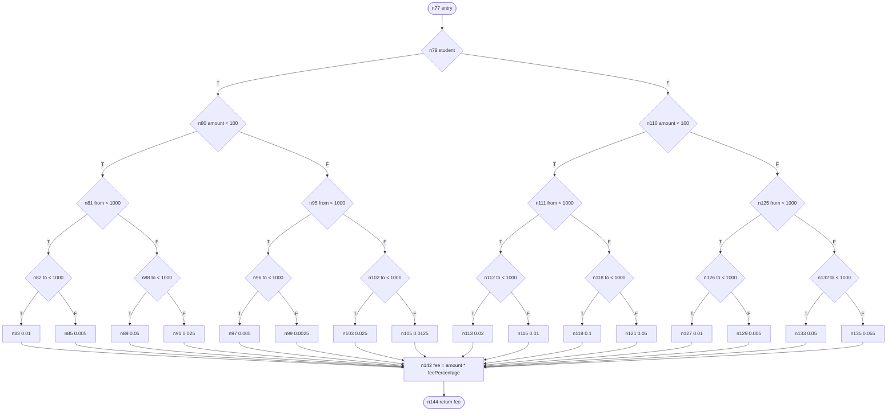

# Assignment 2: White-Box Testing and Fault Localization

CS4472B, group 6. Target: `bank.utils.FeesCalculator`.

| Operation | Technique | Issue | Owner |
|---|---|---|---|
| Withdrawal | Slice on `FinalUse(fee)` + statement coverage | #3 | TODO |
| Deposit | DU-paths for `interestPercentage` + statement coverage | #4 | TODO |
| Transfer | Basis path testing | #5 | Sophia Tong |
| Bonus | Any of the three, outside `FeesCalculator` | #6 | TODO |

> **How to use this file.** Fill in only the sections for your issue and replace their `TODO`
> markers. Don't change another operation's section or the shared conventions; raise changes to
> those on #7 instead. Delete this note in the graded PR.

---

## Conventions

These apply to every section and every test class. Questions and changes go on #7.

### Case IDs
- Prefixes: `WD` (withdrawal), `DP` (deposit), `TR` (transfer), `BN` (bonus).
- Two-digit numbers: `WD-01`, `WD-02`, ... The same ID is used in the test-case table, in the
  `@CsvSource` row, in the results table and in the fault-localization table.

### Floating-point tolerance
- One tolerance for every assertion: `DELTA = 1e-6`.
- Declare it in each test class as `private static final double DELTA = 1e-6;`.

### Control-flow graphs
- Number CFG nodes by **source line** in `src/main/java/bank/utils/FeesCalculator.java` as it is
  on `dev`. A node is written `n<line>` (for example `n30`).
- The source is not changed in this assignment, so the line numbers stay fixed.
- Graphs are drawn in Mermaid (` ```mermaid ` blocks) so they render on GitHub.

Line reference:

| Method | Lines | Target statement |
|---|---|---|
| `calculateWithdrawalFee` | 6–31 | `return fee;` (line 30) |
| `calculateDepositInterest` | 33–73 | `double interest = amount * interestPercentage;` (line 70) |
| `calculateTransferFee` | 75–145 | whole method (basis paths) |

### Inputs and oracles
- Expected values come from the **A2 fee figures in the README**, never from what the code returns.
  The A2 figures differ from A1's.
- Every test-case row cites the README clause its expected value comes from.
- `dayOfWeek` uses `java.util.Calendar` constants: 1 = Sunday, 2 = Monday, ..., 7 = Saturday.
- Expected values are fees in dollars, computed as `amount × percentage` (for example 0.2% of $200 = `0.4`).

### Test classes
- JUnit 5, under `src/test/java` in the package of the class under test.
- One class per issue: `bank.utils.WithdrawalFeeTest`, `bank.utils.DepositInterestTest`,
  `bank.utils.TransferFeeTest`. Bonus classes go in the package of the class they test.
- `@ParameterizedTest` + `@CsvSource`, with the case ID as the first column.
- Every row states the structural element it covers, and every test calls the target method.
- Checkstyle must pass: `mvn -B checkstyle:check`.
- Leave the starter `FeesCalculatorTest` alone; #7 decides what to do with it.

Template (replace the placeholders):

```java
package bank.utils;

import static org.junit.jupiter.api.Assertions.assertEquals;

import org.junit.jupiter.api.DisplayName;
import org.junit.jupiter.params.ParameterizedTest;
import org.junit.jupiter.params.provider.CsvSource;

class XxxFeeTest {
	private static final double DELTA = 1e-6;

	private final FeesCalculator calculator = new FeesCalculator();

	@ParameterizedTest(name = "{0}: {1}")
	@DisplayName("Xxx: <technique>")
	@CsvSource({
		// id, structural element covered, inputs..., expected fee
		"XX-01, '<slice statements / DU-path / basis path>', ..., ...",
	})
	void xxxFee(String id, String covers, /* inputs */ double expected) {
		assertEquals(expected, calculator.calculateXxx(/* inputs */), DELTA);
	}
}
```

### Pull requests
- Short-lived branch off `dev`, PR into `dev`, `phase:tests` label, 3 approvals.
- Quote the JaCoCo numbers from your PR's coverage comment in your section.
- Don't fix faults in the source.

---

## Shared assumptions

1. **Tolerance.** All expected values are compared with `DELTA = 1e-6`, well below one cent and
   far below the gap between any two fee percentages in the specification.
2. **No rounding.** The README tells us to ignore the `round` call for withdrawal and notes
   `Math.round` for deposit. Neither call is in the code: withdrawal returns `amount * feePercentage`
   (line 28) and deposit computes `amount * interestPercentage` (line 70). We analyse the code as it is.
3. **Withdrawal balance of exactly $10,000.** The specification gives a fee for balances below
   $10,000 and for balances above $10,000, but not for exactly $10,000. This is a gap in the
   specification, so no test uses exactly $10,000 as its oracle. Statement coverage of the slice
   does not need that value.
4. **Day of week.** `dayOfWeek` follows `java.util.Calendar`. Saturday (7) and Sunday (1) are the weekend.
5. **Fees are positive amounts in dollars.** Inputs use positive amounts and balances unless a
   section states otherwise.

TODO (#3–#5 owners): add any other assumption your analysis needs here if it affects more than one
operation. Otherwise put it in your own section.

---

## Section 1: Process and assumptions

### 1.1 Withdrawal: slice on `FinalUse(fee)` (#3)

TODO (#3):
- **Slicing criterion:** `FinalUse(fee)` at line 30.
- **The slice:** the statements by line number, each with why it is in the slice (data or control
  dependence on `fee`). Say whether the `if` predicates are included and why.
- **Process:** how the slice was computed.
- **Assumptions** specific to withdrawal.
- **How the test cases cover every statement in the slice.**

### 1.2 Deposit: DU-paths for `interestPercentage` (#4)

TODO (#4):
- **Definitions and use:** every definition of `interestPercentage` (by line) and its use at line 70.
- **DU-path table:**

| DU-path | Def (line) | Use (line) | Path (nodes) | Definition-clear? |
|---|---|---|---|---|
| | | | | |

- **Process:** how the paths were found, and how each path's statements are covered.
- **Assumptions** specific to deposit.

### 1.3 Transfer: basis path testing (#5)

**Target:** `FeesCalculator#calculateTransferFee` (lines 75–145).

#### Control-flow graph

Nodes are numbered by source line. Decision nodes are the `if` lines; each leaf node is one
`feePercentage = ...` assignment. `n77` is the method entry (the declaration of `feePercentage`), `n142` is
`double fee = amount * feePercentage;` and `n144` is `return fee;`.



#### Cyclomatic complexity

| Method | Working | V(G) |
|---|---|---|
| E − N + 2 | N = 34 (1 entry + 15 decisions + 16 assignments + n142 + n144). E = 48 (1 + 15×2 + 16 + 1). 48 − 34 + 2 | **16** |
| Predicates + 1 | 15 simple predicates: n79, n80, n81, n82, n88, n95, n96, n102, n110, n111, n112, n118, n125, n126, n132. 15 + 1 | **16** |
| Regions | Each of the 15 binary decisions closes one bounded region, plus the outer region. 15 + 1 | **16** |

All three agree: **V(G) = 16**, so the basis set has 16 linearly independent paths and we need 16 tests.

#### Baseline path and basis set

**Baseline (P1):** take the TRUE branch at every decision: student, amount < $100, from < $1,000,
to < $1,000. We chose it because it is the first branch in source order, and it is a normal, valid
transfer (McCabe's method says to start from a typical path).

The other 15 paths come from flipping one decision at a time, as McCabe's method does. Each time we
reach a decision that hasn't been flipped yet, we flip it and take the TRUE branch at every later
decision. decision. Each new path uses at least one edge that no earlier path used, so the 16 paths are
linearly independent.

| Path | Flipped decision (from) | Node sequence |
|---|---|---|
| P1 | baseline | n77 → n79T → n80T → n81T → n82T → n83 → n142 → n144 |
| P2 | n82 (P1) | n77 → n79T → n80T → n81T → n82F → n85 → n142 → n144 |
| P3 | n81 (P1) | n77 → n79T → n80T → n81F → n88T → n89 → n142 → n144 |
| P4 | n88 (P3) | n77 → n79T → n80T → n81F → n88F → n91 → n142 → n144 |
| P5 | n80 (P1) | n77 → n79T → n80F → n95T → n96T → n97 → n142 → n144 |
| P6 | n96 (P5) | n77 → n79T → n80F → n95T → n96F → n99 → n142 → n144 |
| P7 | n95 (P5) | n77 → n79T → n80F → n95F → n102T → n103 → n142 → n144 |
| P8 | n102 (P7) | n77 → n79T → n80F → n95F → n102F → n105 → n142 → n144 |
| P9 | n79 (P1) | n77 → n79F → n110T → n111T → n112T → n113 → n142 → n144 |
| P10 | n112 (P9) | n77 → n79F → n110T → n111T → n112F → n115 → n142 → n144 |
| P11 | n111 (P9) | n77 → n79F → n110T → n111F → n118T → n119 → n142 → n144 |
| P12 | n118 (P11) | n77 → n79F → n110T → n111F → n118F → n121 → n142 → n144 |
| P13 | n110 (P9) | n77 → n79F → n110F → n125T → n126T → n127 → n142 → n144 |
| P14 | n126 (P13) | n77 → n79F → n110F → n125T → n126F → n129 → n142 → n144 |
| P15 | n125 (P13) | n77 → n79F → n110F → n125F → n132T → n133 → n142 → n144 |
| P16 | n132 (P15) | n77 → n79F → n110F → n125F → n132F → n135 → n142 → n144 |

Every path is feasible: the four decisions test four independent inputs, so any TRUE/FALSE
combination can be reached.

#### Assumptions (transfer)

1. **Node numbering.** Nodes are source lines. Closing braces of the `if`/`else` blocks are join
   points with no statement, so they don't get nodes of their own. Each assignment node goes
   straight to `n142`. Adding separate join nodes would add the same number of nodes and edges,
   so V(G) would not change.
2. **Predicates.** Every `if` tests one simple condition, so each one counts as one predicate.
3. **Input values.** These are representative values, not boundary values, because basis path
   testing only has to drive each path: `amount` is 50 (< $100) or 200 (≥ $100). Balances are 500
   (< $1,000) or 2,000 (≥ $1,000).
4. **Oracle.** Expected fee = `amount × percentage`, with the percentage taken from the README A2
   "Transfer" clause for that path.
5. **Tolerance.** `DELTA = 1e-6` (shared assumption 1).

#### Coverage (from the JaCoCo report on PR #9)

From the `jacoco-report` artifact of the PR #9 CI run, `FeesCalculator` page:

| Method | Instruction coverage | Branch coverage | Lines covered | Cyclomatic complexity |
|---|---|---|---|---|
| `calculateTransferFee` | 100% | 100% | 33 / 33 | 16 |

The 16 basis paths run every statement and both outcomes of all 15 decisions. JaCoCo's own
complexity count (16) matches the V(G) computed above. At class level, `FeesCalculator` is at 64%
instructions and 61% branches on this run, because the withdrawal and deposit tests are not merged
yet. The coverage comment on the PR shows only the overall project figure (7.2%), because this PR
doesn't change any main source file.

### 1.4 Bonus: faults outside `FeesCalculator` (#6)

TODO (#6, or delete this section if #6 is dropped on Nov 30):
- **Class and method** under test, and why it was picked.
- **Technique** and analysis artifact (slice, DU-path table or CFG + basis paths).
- **Oracle source:** the A2 fee figures or the A1 ATM session rules, stated for each test.
- **Test doubles** used, if any (stub `FeesCalculator` so its faults don't show up here as new ones).
- **Assumptions.**

---

## Section 2: Test cases

Columns are the same for every operation. "Covers" names the slice statements, DU-path or basis
path the case was built for. "Spec clause" is the README bullet the expected value comes from.

### 2.1 Withdrawal (#3)

| ID | Covers | `amount` | `accountBalance` | `student` | `dayOfWeek` | Expected fee | Spec clause |
|---|---|---|---|---|---|---|---|
| WD-01 | | | | | | | |

### 2.2 Deposit (#4)

| ID | Covers | `amount` | `accountBalance` | `student` | Expected interest | Spec clause |
|---|---|---|---|---|---|---|
| DP-01 | | | | | | |

### 2.3 Transfer (#5)

| ID | Covers | `amount` | `fromAccountBalance` | `toAccountBalance` | `student` | Expected fee | Spec clause |
|---|---|---|---|---|---|---|---|
| TR-01 | P1 (n83) | 50 | 500 | 500 | true | 0.05 | Student, < $100, from < $1,000, to < $1,000: 0.1% |
| TR-02 | P2 (n85) | 50 | 500 | 2000 | true | 0.025 | Student, < $100, from < $1,000, otherwise: 0.05% |
| TR-03 | P3 (n89) | 50 | 2000 | 500 | true | 0.25 | Student, < $100, from ≥ $1,000, to < $1,000: 0.5% |
| TR-04 | P4 (n91) | 50 | 2000 | 2000 | true | 0.125 | Student, < $100, from ≥ $1,000, otherwise: 0.25% |
| TR-05 | P5 (n97) | 200 | 500 | 500 | true | 0.1 | Student, ≥ $100, from < $1,000, to < $1,000: 0.05% |
| TR-06 | P6 (n99) | 200 | 500 | 2000 | true | 0.05 | Student, ≥ $100, from < $1,000, otherwise: 0.025% |
| TR-07 | P7 (n103) | 200 | 2000 | 500 | true | 0.5 | Student, ≥ $100, from ≥ $1,000, to < $1,000: 0.25% |
| TR-08 | P8 (n105) | 200 | 2000 | 2000 | true | 0.25 | Student, ≥ $100, from ≥ $1,000, otherwise: 0.125% |
| TR-09 | P9 (n113) | 50 | 500 | 500 | false | 0.1 | Non-student, < $100, from < $1,000, to < $1,000: 0.2% |
| TR-10 | P10 (n115) | 50 | 500 | 2000 | false | 0.05 | Non-student, < $100, from < $1,000, otherwise: 0.1% |
| TR-11 | P11 (n119) | 50 | 2000 | 500 | false | 0.5 | Non-student, < $100, from ≥ $1,000, to < $1,000: 1% |
| TR-12 | P12 (n121) | 50 | 2000 | 2000 | false | 0.25 | Non-student, < $100, from ≥ $1,000, otherwise: 0.5% |
| TR-13 | P13 (n127) | 200 | 500 | 500 | false | 0.2 | Non-student, ≥ $100, from < $1,000, to < $1,000: 0.1% |
| TR-14 | P14 (n129) | 200 | 500 | 2000 | false | 0.1 | Non-student, ≥ $100, from < $1,000, otherwise: 0.05% |
| TR-15 | P15 (n133) | 200 | 2000 | 500 | false | 1.0 | Non-student, ≥ $100, from ≥ $1,000, to < $1,000: 0.5% |
| TR-16 | P16 (n135) | 200 | 2000 | 2000 | false | 0.5 | Non-student, ≥ $100, from ≥ $1,000, otherwise: 0.25% |

### 2.4 Bonus (#6)

| ID | Class#method | Covers | Inputs | Expected | Oracle source |
|---|---|---|---|---|---|
| BN-01 | | | | | |

---

## Test results

Must match the JUnit report on the graded PR's CI run.

| ID | Test class | Result (pass/fail) |
|---|---|---|
| TR-01 | TransferFeeTest | fail |
| TR-02 | TransferFeeTest | fail |
| TR-03 | TransferFeeTest | fail |
| TR-04 | TransferFeeTest | fail |
| TR-05 | TransferFeeTest | fail |
| TR-06 | TransferFeeTest | fail |
| TR-07 | TransferFeeTest | fail |
| TR-08 | TransferFeeTest | fail |
| TR-09 | TransferFeeTest | fail |
| TR-10 | TransferFeeTest | fail |
| TR-11 | TransferFeeTest | fail |
| TR-12 | TransferFeeTest | fail |
| TR-13 | TransferFeeTest | fail |
| TR-14 | TransferFeeTest | fail |
| TR-15 | TransferFeeTest | fail |
| TR-16 | TransferFeeTest | fail |

## Coverage

From the JaCoCo comment on the graded PR's final CI run (#7).

| Class | Line coverage | Branch coverage |
|---|---|---|
| `bank.utils.FeesCalculator` | TODO | TODO |

Per-PR numbers: each owner quotes the JaCoCo numbers from their own PR in their section 1 subsection.

## Fault localization

One row per fault. Group every failing test that exposes the same fault in one row. Same columns
as the PR template.

| Failing test(s) | Suspected fault (file, method, line) | One-line justification |
|---|---|---|
| TR-01 – TR-15 | `FeesCalculator.java`, `calculateTransferFee`, lines 83, 85, 89, 91, 97, 99, 103, 105, 113, 115, 119, 121, 127, 129, 133 (`feePercentage = ...`) | Each test reaches exactly one assignment and every fee comes back 10× the spec (for example, TR-01 returns 0.5 instead of 0.05), so each `feePercentage` constant is off by one decimal place. |
| TR-16 | `FeesCalculator.java`, `calculateTransferFee`, line 135 (`feePercentage = 0.055`) | P16 is the only path through line 135 and returns 11.0 instead of 0.5 (22×), which doesn't fit the 10× pattern, so line 135 has its own wrong constant (0.055 where the spec says 0.0025). |

## Failure log

Kept for Assignment 3. Add a row as soon as a failure is found, not at the end.

| Failure ID | Exposing test(s) | Method | Time testing before found | Time diagnosing | Found by |
|---|---|---|---|---|---|
| F-01 | TR-01 – TR-15 | calculateTransferFee | ~45 min | ~10 min | Sophia Tong |
| F-02 | TR-16 | calculateTransferFee | ~45 min | ~10 min | Sophia Tong |
